<!-- UPDATE LOG (2026-10-31): Fixed mobile and responsive boundary overflow in metrics strip and skills matrix. Optimized column descriptions with compact typography and generous safety margins in metrics-strip.svg; introduced .tag-text-xs with optimized font size and positioning for WhatsApp API, Premiere / InD, G-Workspace, and Tailwind CSS in stack-matrix.svg to keep all text strictly within container borders across all screen sizes. -->

<!-- ==================== HERO MASTHEAD ==================== -->

  

<!-- ==================== IMPACT METRICS STRIP ==================== -->

  

<!-- ==================== CORE PILLARS BENTO ==================== -->

  

<!-- ==================== PROJECT CHARTER ==================== -->

  

<!-- ==================== STACK MATRIX ==================== -->

  

<!-- ==================== STEALTH STATS & GIT ACTIVITY ==================== -->

  

<!-- ==================== CONTRIBUTIONS MATRIX RADAR ==================== -->

  

<!-- ==================== CONNECT & COLLABORATE ==================== -->

&nbsp;&nbsp;

&nbsp;&nbsp;

